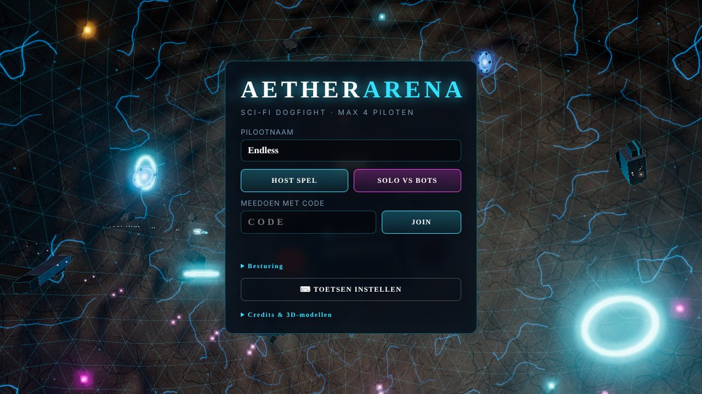
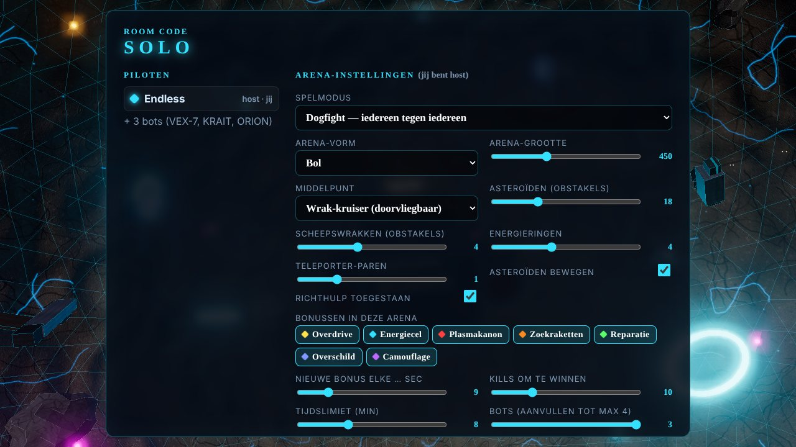
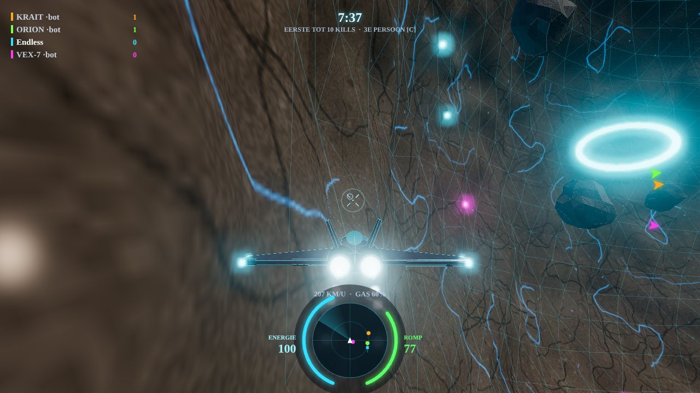
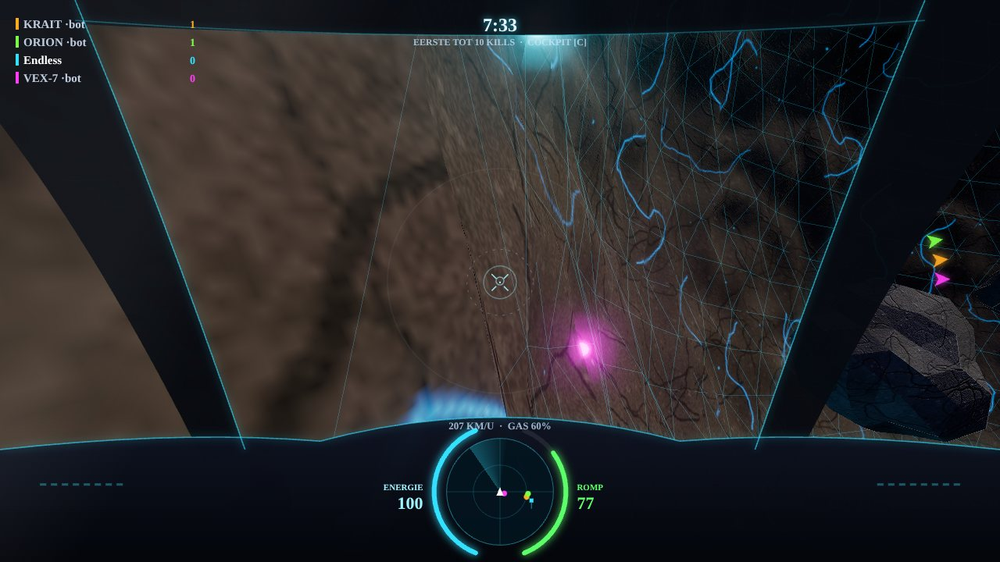
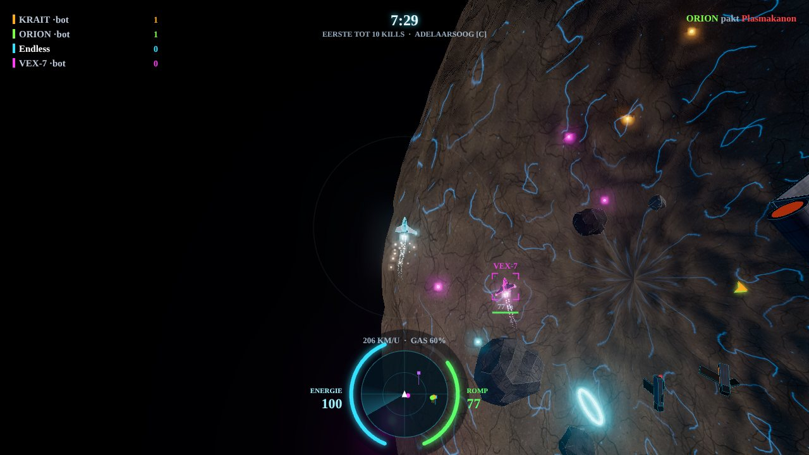
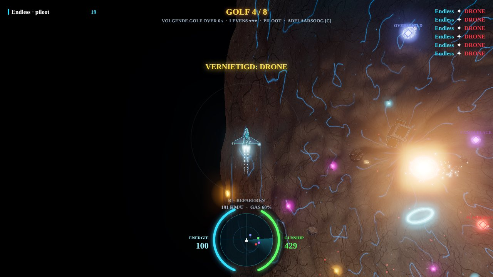
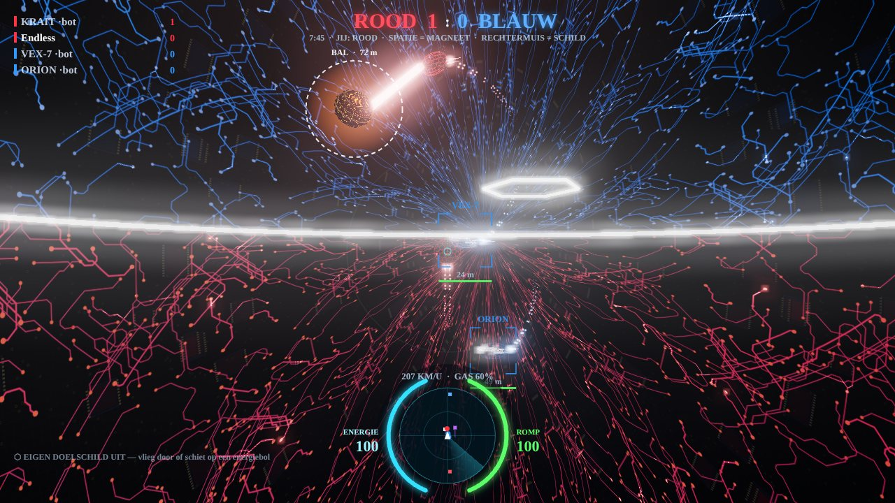
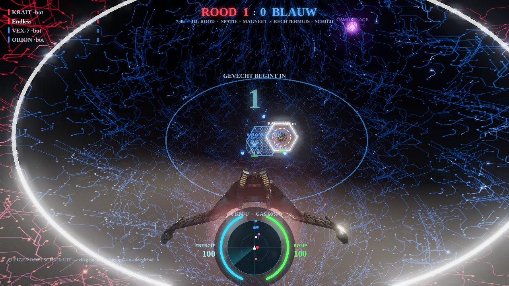
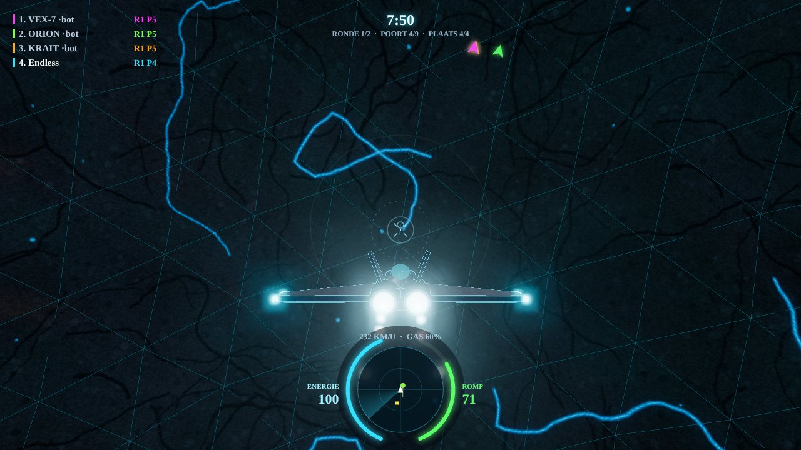

# Aether Arena

Sci-fi 3D dogfight voor maximaal 4 spelers, in één HTML-bestand. Speel online via GitHub Pages:
**https://endless1977.github.io/aether-arena/**

## Zo speel je samen
1. Eén speler klikt op **Host spel** en krijgt een code van 5 tekens (of een deelbare link).
2. De anderen vullen die code in bij **Meedoen met code** en klikken op **Join**.
3. De host kiest de spelmodus en de arena-instellingen en start het gevecht. Lege plekken worden opgevuld met bots.

Je kunt ook alleen spelen met **Solo vs bots**. Het spel werkt het best in Chrome of Edge, met muis en toetsenbord. Het draait volledig in de browser. De verbinding tussen spelers loopt peer-to-peer via PeerJS en er is geen eigen server nodig.

## Spelmodi
- **Dogfight**: iedereen tegen iedereen; wie het eerst het ingestelde aantal kills haalt, wint.
- **Instagib**: railgun, één treffer is dood.
- **Race**: vlieg door de genummerde poorten, ook dwars door de wrak-kruiser heen.
- **Horde**: samen in één gunship. Eén speler is piloot, de anderen bemannen de wapenkoepels of zijn co-piloot (repareren en schild). Jullie vechten tegen golven drones, bombers en bazen.
- **Voetbal**: rood (Bird of Prey) tegen blauw (Enterprise) in een ovaal elektro-stadion. Er zijn drie varianten: zonder schade, met dogfight of met instagib.
  - Pak de bal met de magneetstraal. Je kunt hem maar een ingestelde tijd vasthouden.
  - Met je schild kaats je de bal af of pak je hem af.
  - Doelschilden laad je op met energiebollen.
  - Een aftrapschild beschermt de bal bij de aftrap.

| Dogfight (3e persoon) | Cockpit |
|---|---|
|  |  |

| Adelaarsoog | Horde |
|---|---|
|  |  |

| Voetbal | Voetbal: aftrap met kickoff-schild |
|---|---|
|  |  |

## Wat zit erin
- **Drie camerastanden**: cockpit, 3e persoon en adelaarsoog. Je wisselt met **C** en zoomt met het scrollwiel.
- **Arena-instellingen** voor de host:
  - vorm (bol, kubus, …) en grootte van de arena
  - middelpunt: planeet of doorvliegbare wrak-kruiser
  - aantal asteroïden (eventueel bewegend), scheepswrakken, energieringen en teleporters (met telefrag)
  - welke bonussen meedoen
  - kill-limiet, tijdslimiet en aantal bots
- **Bonussen**: overdrive, energiecel, plasmakanon, zoekraketten, reparatie, overschild en camouflage.
- **Richthulp**: doel-lock, eventueel met stuurhulp. De host kan dit uitzetten.
- **Eigen 3D-modellen** (GLB) voor schip en arena, met een voorbeeldweergave om de oriëntatie te controleren.
- **Eigen geluiden**: je kunt mp3's koppelen aan de spelgeluiden.
- **Bediening**: alle toetsen zijn aan te passen via **Toetsen instellen**. Pointer-lock en volledig scherm worden automatisch geregeld.

## Besturing (standaard)
| Toets | Actie |
|---|---|
| Muis | neus sturen |
| A / D | rollen |
| W / S | gas erbij / eraf |
| Shift | naverbrander (kost energie) |
| Linkermuis | vuren |
| Rechtermuis / Spatie | schild |
| F / middelste muis | zoekraket (bonus) |
| C | camera wisselen |
| X | stuurknuppel centreren |
| Tab | scorebord |
| M | muziek aan/uit |
| Esc | pauzemenu (het gevecht loopt door) |
| Spatie (voetbal) | magneetstraal: bal pakken, loslaten = schieten |

## Techniek
Het spel is één `index.html` met de 3D-modellen ingebakken. Het gebruikt:
- Three.js 0.160 met bloom
- PeerJS 1.5.4 voor multiplayer; de host bepaalt de spelstatus
- WebAudio voor de geluidseffecten

## Credits 3D-modellen
- **Robot Ball**: [grabthesky](https://sketchfab.com/grabthesky), [Sketchfab](https://sketchfab.com/3d-models/robot-ball-adbb26da045e4ca8aad09461e414f2a5), CC-BY 4.0
- **Star Trek – Bird of Prey (Enterprise)**: [Wholock](https://sketchfab.com/wholock), [Sketchfab](https://sketchfab.com/3d-models/star-trek-bird-of-prey-enterprise-3af27d1d17f84f08a1d7dbbec811b042), CC-BY 4.0
- **Enterprise NCC-1701-D**: [morenostefanuto](https://sketchfab.com/morenostefanuto), [Sketchfab](https://sketchfab.com/3d-models/enterprise-ncc-1701-d-6f05e0d3448146a6a65ff2cf6c28040e), Sketchfab Standard-licentie

De modellen zijn voor dit spel verkleind en geoptimaliseerd. Star Trek is een handelsmerk van Paramount. Dit is een niet-commercieel fanproject voor vrienden.

Gemaakt door Endless (Joris Zuijdervliet).
